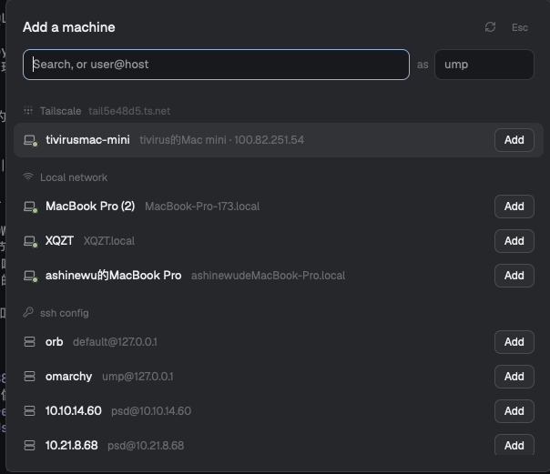

# Tailscale Machines for Herdr

Add a machine in [Herdr](https://herdr.dev) without typing: your Tailscale tailnet, the local network and your ssh config, in one searchable list.



- **Tailscale** computers first, online ones on top
- **Local network** Macs and Linux boxes that announce ssh
- **ssh config** hosts, without GitHub / GitLab
- Search, ↑ ↓, Enter to add; or type `user@host`
- A password or host key? *Answer in a terminal*, and it's added

## Install

```sh
git clone https://github.com/Umupa/herdr-tailscale-machines.git
cp -R herdr-tailscale-machines/mods/* ~/.config/herdr-app/mods/
```

Open it with ⌘⇧M by adding to `~/.config/herdr-app/keys.json`:

```json
{ "global": { "cmd-shift-m": "mod.open:tailscale-machines" } }
```

To make the sidebar's **Add machine** open it too, set the footer block in your layout to `tailscale-footer`:

```json
{ "id": "sidebar-footer", "type": "block", "content": { "mod": "tailscale-footer", "props": { "footer": true } } }
```

## Notes

Runs `tailscale status`, `dns-sd` (macOS) or `avahi-browse` (Linux) and `hc machine` while open; reads `~/.ssh/config`. No network of its own. Not affiliated with Tailscale. Apache-2.0, see [NOTICE](NOTICE).
