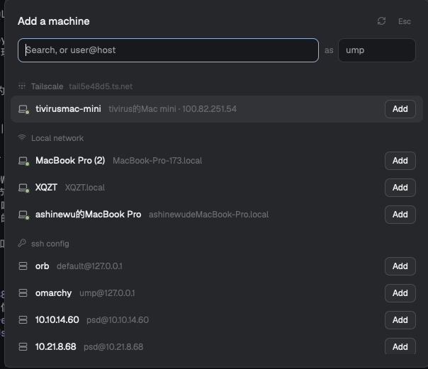

# Tailscale Machines for Herdr

[English](README.md)

在 [Herdr](https://herdr.dev) 里添加机器不用再手输：Tailscale、局域网和 ssh config 的机器在一个可搜索的列表里。



- **Tailscale** 的机器排在最前，在线的在上面
- **局域网**里开了 ssh 的机器
- **ssh config** 里的主机，去掉 GitHub / GitLab
- 搜索，↑ ↓ 选择，回车添加；也可以直接输入 `user@host`
- 从 Mac 的电脑名猜 ssh 用户，也可以在 **as** 里填
- 新的主机密钥？点 **Trust and add**。要密码？复制那一条命令去终端运行

## 让 agent 安装

把这段发给 Herdr 里的 agent：

```text
安装 Herdr mod https://github.com/Umupa/herdr-tailscale-machines：
把 mods/ 下的两个文件夹复制到 ~/.config/herdr-app/mods/，分别用 herdr-app check 检查，
在我的 keys.json 里把 cmd-shift-m 绑定到 "mod.open:tailscale-machines"，
再把我布局里 sidebar-footer 那一块的 mod 改成 "tailscale-footer"。
```

## 手动安装

```sh
git clone https://github.com/Umupa/herdr-tailscale-machines.git
cp -R herdr-tailscale-machines/mods/* ~/.config/herdr-app/mods/
```

快捷键，写进 `~/.config/herdr-app/keys.json`：

```json
{ "global": { "cmd-shift-m": "mod.open:tailscale-machines" } }
```

想让侧边栏左下角的 **Add machine** 也打开它，把布局里的页脚那一块改成：

```json
{ "id": "sidebar-footer", "type": "block", "content": { "mod": "tailscale-footer", "props": { "footer": true } } }
```

## 说明

打开时会运行 `tailscale status`、`dns-sd` / `avahi-browse`、`ssh-keyscan` 和 `hc machine`，并读取 `~/.ssh/config`，自己不联网。与 Tailscale 公司无关。Apache-2.0，见 [NOTICE](NOTICE)。
