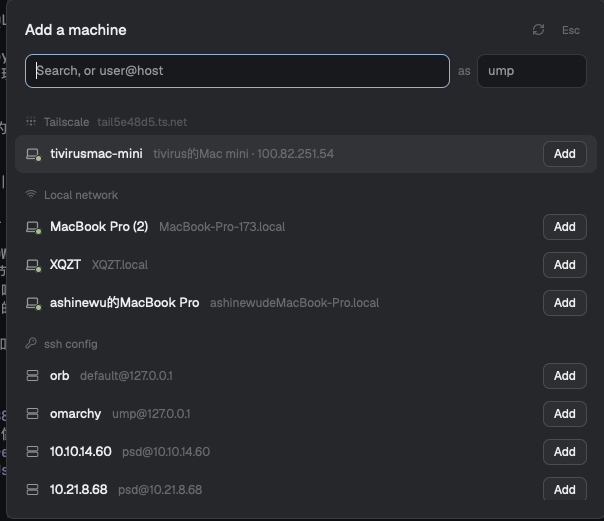

# Tailscale Machines

A dialog that replaces typing in Herdr's Add a machine: it lists computers found on your Tailscale tailnet, on the local network (ssh over mDNS) and in `~/.ssh/config`, searchable from one field, each added with one click or Enter.

**What you see:**

- A 600px dialog (`mod.json` overlay `{kind: "dialog", width: 600}`), `t.popover`, 18px padding, 12px gaps.
- Title row: "Add a machine" (15px semibold), a 13px Lucide `refresh-cw` button and "Esc" (11px, `t.dim`).
- A field row: the search field (flex, 34px, 8px radius, `t.input` border, `t.accent` when focused, placeholder "Search, or user@host"), then `as` and a 110px user field (placeholder: the local user name).
- A list up to 400px tall, scrolling, flat children: per section a header (11.5px medium `t.dim`, 12px icon, title; Tailscale also shows the MagicDNS suffix; a spinning `spinner.svg` while it loads) and 38px rows: 15px icon with a 7px status dot (Tailscale and LAN: `t.ansi2` online, `t.dim` offline), the title (13px, max 240px, truncated), a `t.dim` 12px subtitle, and on the right an "Add" button (26px, `t.raised`, `t.input` border), "Connecting" with a spinner, "Added" (`t.ansi2`, `circle-check`) plus "New space", or for offline peers "3h ago".
- Sections: **Tailscale** (`icons/tailnet.svg`, an original 3×3 dot grid), **Local network** (Lucide `wifi`), **ssh config** (Lucide `key-round`). A section with nothing shows one `t.dim` line ("Not installed", "Tailscale is stopped", "No other computers on your tailnet", "Nothing here announces ssh", "No hosts").

**How it behaves:**

- Opening starts three reads at once: `tailscale status --json` (falls back to `/Applications/Tailscale.app/Contents/MacOS/Tailscale`), the LAN scan, `~/.ssh/config` (with `Include`, as Herdr's machine-add). Tailscale and `hc machine ls --json` repeat every 8 s while open; ↻ repeats all.
- Tailscale rows: peers minus `ShareeNode` and OS iOS/android/tvOS; sorted online, own `UserID`, name. Title is the MagicDNS label, subtitle `HostName · first IP`, target `[user@]<MagicDNS name>`, `--name` the label. Offline rows are at 50% opacity and can't be added.
- LAN rows (macOS): `dns-sd -B _ssh._tcp` for 1.5 s, each instance resolved with `dns-sd -L` for 1.2 s in parallel; drops this computer (`scutil --get LocalHostName`). Linux: `avahi-browse -rtp _ssh._tcp`, IPv4 lines. Target `[user@]host.local[:port]`.
- ssh config rows: the alias as target, without `User git` hosts and GitHub / GitLab / Gitee / Bitbucket / Codeberg / Gitea / sourcehut names.
- Typing filters every section by title, subtitle and host; sections with no match hide. Text with `@`, `.` or `:` and no spaces adds a "Typed" row. ↑/↓ (or Ctrl-P/N) move a highlight over rows that can be added, scrolling it into view; Enter adds it. Esc closes.
- `as`: prefixed as `user@` to Tailscale and LAN targets; kept in localStorage.
- Add: `hc machine add <target> --json [--name <name>]`. A row counts as added when a non-temporary machine in `hc machine ls` has that target, name or host. Errors of kind `hc_missing`, `incompatible`, `login_needed`, `auth_failed`, `host_key` (or password / host key wording) show "Answer in a terminal" (`hc run --json --bg --no-parent --rm` of the same command plus "Press Enter to close", then closes the dialog and `terminal.peek`s it) and "Copy command". Other errors show their message.
- "New space": closes the dialog and runs `space.new {machine}`.

**Built from:**

- `mods/tailscale-machines/main.js`, `mod.json`, `icons/` (Lucide `laptop`, `wifi`, `refresh-cw`, `square-terminal`, `key-round`; own `tailnet.svg`; Herdr's `workspace-chrome` `server`, `spinner`, `circle-check`).
- herdr: `hc`, `exec`, `home`, `readTextFile`, `theme`, `props`, `closeOverlay`, `run`, `window`. gpui-base: `InputState`/`Input`, `TextView`, `ScrollHandle`.
- Opened by `mod.open tailscale-machines` (`keys.json`: `cmd-shift-m`), and by the sidebar footer's Add machine through `mods/tailscale-footer`: `mod.clone workspace-chrome` with that row's `mod.open` name changed, used as the layout's `sidebar-footer` block (`props: {footer: true}`).

**Watch out:**

- A mod can't be named `machine-add` (Herdr's shipped one wins). Settings → Machines and the welcome screen keep opening Herdr's window; only the footer is replaced, and its fork doesn't follow later workspace-chrome changes.
- `dns-sd` never exits on its own: run it in the background and kill it after a sleep, all inside one `sh -c`.
- Tailscale `HostName`s may hold spaces and CJK; use the MagicDNS label for the machine name.

**Done when:**

- With Tailscale running, the tailnet's computers appear first, online before offline; phones don't.
- A Mac with Remote Login on the same network appears under Local network; this computer doesn't.
- Typing narrows all sections; Enter adds the highlighted row, and it turns Added without reopening.
- A machine that needs a password offers Answer in a terminal, and finishing there turns its row Added.
- `herdr-app check ~/.config/herdr-app/mods/tailscale-machines` passes.
